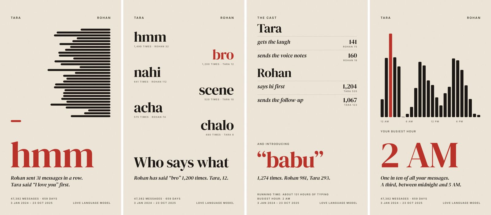

# Love Language Model

> Not an LLM. It just counts things, very judgmentally.

[](https://github.com/Chaitaneya/Love-Language-Model/actions/workflows/ci.yml)


**Drop in a WhatsApp chat and get a movie poster of your relationship**, made from true moments in it: the first message, who replies in 23 minutes, the 31 messages in a row and the "hmm" that answered them.

The counting runs **inside your browser** (Python compiled to WebAssembly), so the chat never leaves the tab. There is no server to send it to and no database to keep it in.

<p align="center">
  
  &nbsp;&nbsp;
  
</p>

<sub>Rohan and Tara are not real. They are a synthetic 47,382-message chat, generated with every fact planted on purpose (<a href="docs/STATS.md">docs/STATS.md §6</a>), so every number the app shows can be checked against ground truth.</sub>

## What you get

1. **Six highlights**, one per screen: how it started, who is quicker, who talks and who answers, your biggest day, the words each of you says, and who said "I love you" first. Each one is a real number, date or quote, with one plain line on how we know.
2. **Four cards to keep**, each a 1080 × 1920 image:
   - **The poster.** One bar for each message in your longest run, each as long as the real message, and the reply as the title. Add a photo if you like; it is edited on your phone and never uploaded.
   - **Words.** The words that are most "you" and most "them", with the counts.
   - **Cast.** Each habit billed to whoever does it more, with both numbers printed: *gets the laugh 141 · Rohan 75*. No labels like "the ghost".
   - **Hour.** All 24 hours of your messages, your busiest in red.
3. **Leave anything off.** Every line and word on a card can be removed with one tap before you save it.
4. **The receipts**, one level deeper: every number with a sentence on how it was counted, and a list of what counting cannot know.

Rules the copy follows: the number is the joke; no scores, weights or decimals anywhere; nothing that pretends to measure feelings (there is no "who loves more"); facts never contradict each other, and when the data seems to, that becomes the line: *Slower to reply, first to say it.*

## Privacy you can check

| | |
|---|---|
| **Look** | "How it works" counts the network requests made since your chat was read. It says `0`. |
| **Watch** | Open DevTools → Network and add a chat. Everything the page needs (Python, the fonts, the code) loads from the same site *before* you pick the file. Nothing goes out after. |
| **Enforced by the browser** | A strict Content-Security-Policy (`default-src 'none'; connect-src 'self'; …`): the page cannot talk to any other site. No inline scripts or styles. |
| **Enforced by a test** | The browser tests drive the production build in Chrome and fail on any request that leaves the site, any upload, any request with a body, or any console error (CSP violations included). |
| **Forget** | "Start over" ends the worker that held the chat and reloads the page. Closing the tab does the same. Nothing was ever stored. |

## How it works

```text
 WhatsApp export (.txt or .zip)
        │  read in the tab, handed to a Web Worker
        ▼
 Pyodide: CPython 3.13 compiled to WebAssembly, served from the same site
   └─ lovelm: pure Python, standard library only
        parse → conversations, replies, streaks → 47 stats  →  one JSON document
        ▼
 JavaScript: the six highlights, the four canvas cards, the receipts
```

- **A dependency-free Python core** ([`core/lovelm`](core/lovelm)). It parses both Android and iPhone exports and works out the date order (`dd/mm` or `mm/dd`) from the file itself. It runs identically on a laptop and in the browser: a smoke test runs the exact browser path in Node and compares its output with native CPython, value for value.
- **One place for words.** [`web/src/facts.js`](web/src/facts.js) turns numbers into every sentence a person reads. It is made of pure functions with tests that check the copy itself: no decimal, score or verdict label ever reaches the page, and the names you type replace the names in every line except real quotes.
- **Canvas cards, one drawing path.** What you see is the image you save. The poster's bars are the actual messages of the run, sent by the core as their lengths.
- **Fluid, honest motion.** The highlights and the sheets use spring physics (damping and response, as Apple describes them), follow your finger, can be caught mid-flight, and keep a flick's speed. Reduced-motion settings get cross-fades instead.
- **Why Python in the browser and not a server?** Privacy you can check beats privacy you are promised. It costs a first load of about 12 MB (cached afterwards).

| On desktop Chrome, 47,382 messages | |
|---|---|
| Start Python / read the chat / analyse it | ≈ 0.7 s / 0.6 s / 2.1 s |
| 100,000 messages, analyse | ≈ 4.5–5 s |

## How the design was decided

The first version was a stats dashboard in a costume: love meters, weighted scores, archetypes with runner-up scores. It was redesigned twice, each time the same way. Three competing prototypes were built from one written brief and scored blind against a rubric (simplicity, honest and specific copy, the poster, interaction craft, phone quality, maintainability). The strongest became the base, and the best ideas of the others were grafted in. A consistency audit against Apple's design guidance then fixed 18 inconsistencies.

Every decision, including what was rejected and why, is in the [decision log](docs/decision.md) (see D45, D47, D48). The briefs, rubrics and every candidate's screens are in [docs/design](docs/design).

## Tests

| Suite | Count | Covers |
|---|---|---|
| Python (pytest + Hypothesis) | 557 | parsing both export formats, date-order inference, every stat against the demo's planted facts, determinism, property-based round trips, the anonymizer |
| JavaScript (`node --test`) | 22 | the highlights and their fallbacks, the words, cast and hour cards, copy rules (no decimals, scores or labels), names, the poster's bars |
| Smoke (Node + Pyodide) | 1 | the browser's exact Python path equals native CPython |
| End to end (Playwright, Chrome) | 10 | privacy, upload, swipe and tap and Back, photo to PNG, the four cards and leaving things off, error files, cancelling a load, phone layout, start over |

The tests were themselves tested: deliberately broken versions of the demo generator and the anonymizer had to make specific tests fail.

## Run it

```bash
cd web && npm install      # Node 22+, Python 3.11+ on the PATH
npm run dev                # http://localhost:5173
```

<details>
<summary>All commands</summary>

```bash
python3 -m venv .venv && .venv/bin/pip install pytest hypothesis
cd core && ../.venv/bin/python -m pytest     # the Python suite

cd web
npm run build      # production build in web/dist, with the strict CSP
npm run preview    # serve that build on http://localhost:4173 (add -- --host to open it on your phone)
npm test           # JavaScript unit tests
npm run smoke      # Python in Node (Pyodide) vs native CPython
npm run e2e        # builds, serves, and runs the browser tests in your installed Chrome
npm run media      # regenerates the GIF and images in this README (needs ffmpeg)
```

The core also works on its own:

```python
from lovelm.api import load_chat, analyze

chat = load_chat(open("demo/demo_chat.txt", "rb").read())
result = analyze(chat, seed=1234)      # a plain, JSON-ready dict
print(result["meta"]["messages"])      # 47382
```
</details>

### Report a chat that doesn't parse, safely

Real chats never go in the repository (`.gitignore` blocks WhatsApp export names). To share an export's *format* without its content:

```bash
python3 tools/anonymize_export.py "WhatsApp Chat with X.txt" -o sample.txt
```

It keeps the structure (timestamps exactly as written, who spoke when, message lengths, emoji, WhatsApp's own placeholders) and replaces every name and every letter and digit with random ones. Before writing, it checks that the sample parses exactly like the original; if not, it writes nothing. Your timestamps are still in the sample, so read it before you share it.

## Repository layout

```text
core/lovelm/      the analysis: parser, date-order inference, stats (pure Python)
core/tests/       pytest + Hypothesis
web/src/          the app: main.js (flow), facts.js (all copy), poster.js (cards), reveal.js, cards.js, sheet.js, spring.js
web/e2e/          Playwright tests against the production build
tools/            the demo-couple generator and the export anonymizer
demo/             the synthetic demo chat and its ground truth
docs/             PRD, stats spec, decision log, design records
```

## Limits, stated up front

- **No real export has been through the parser yet.** It has only seen generated files written to match WhatsApp's export formats as best understood (WhatsApp does not publish them). If yours stumbles, the anonymizer above makes a safe sample.
- **iPhone Safari and real-phone speed are untested.** The speeds above are from a desktop.
- **Keyword counting is crude.** Words are matched by spelling; tone, sarcasm and anything said off the chat are invisible, and the receipts say so.
- **A third person's name typed in lower case** can slip past the name filter into a quote or a word list. That is one reason every line can be left off a card.
- **Names in non-Latin scripts** fall back to the system font on the cards.

## Deploying

`web/dist` is a static site. The [CI workflow](.github/workflows/ci.yml) runs every suite on each push and, once they all pass on `main`, publishes the build to GitHub Pages (Pages has to be switched on in the repository settings, with "GitHub Actions" as the source). The CSP is a `<meta>` tag, so it works on any static host; the build also emits a `_headers` file with extra protections for hosts that read it (Cloudflare Pages, Netlify).

## Roadmap

- **Next:** "Exhibit A", a search for the argument where one of you says "you said last year that…": keyword and fuzzy search over the chat, with context and an evidence card. Retrieval only; nothing is generated.
- **Needs a human:** a real export through the anonymizer, and an iPhone.

## Documents and licence

[PRD](docs/PRD.md) · [Stats spec](docs/STATS.md) · [Decision log](docs/decision.md) · [Design records](docs/design)

MIT ([LICENSE](LICENSE)). The site also ships Pyodide (MPL-2.0), CPython (PSF-2.0) and two font families (SIL OFL 1.1); their notices are generated into `licenses.txt`, linked from the app.
